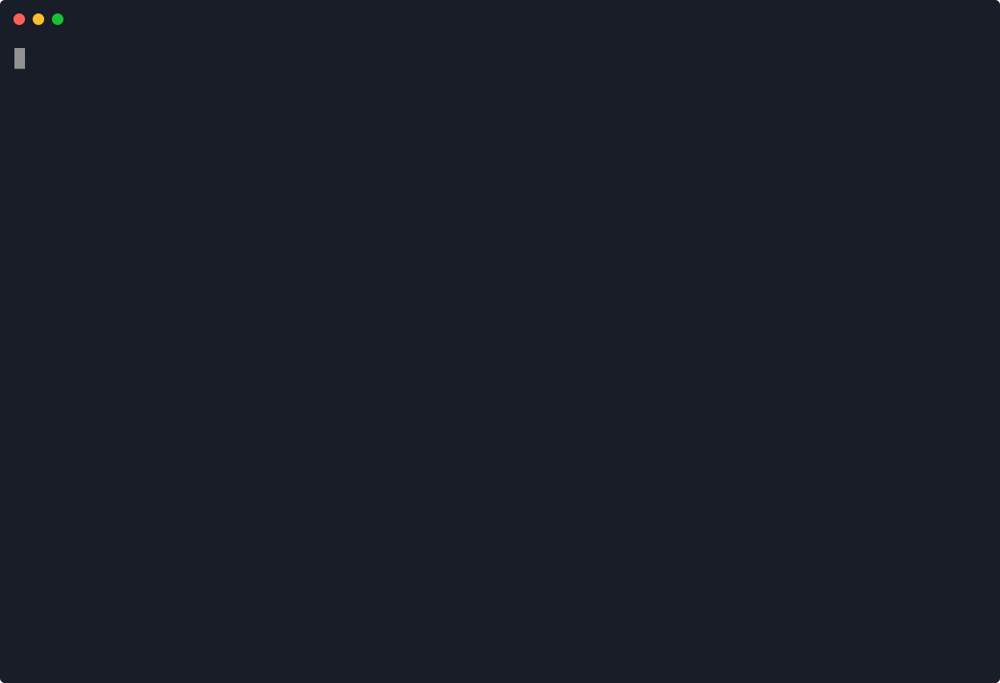

<p align="center">
  
</p>

# fpm-monitor

[](https://github.com/filoucrackeur/fpm-monitor/actions/workflows/ci.yml) [](https://github.com/filoucrackeur/fpm-monitor/releases)
[](https://github.com/filoucrackeur/fpm-monitor/actions/workflows/ci.yml) [](LICENSE) [](Cargo.toml)
   
[](https://github.com/filoucrackeur/fpm-monitor/pkgs/container/fpm-monitor) [](https://github.com/filoucrackeur/fpm-monitor/releases) [](https://github.com/filoucrackeur/fpm-monitor/issues) [](https://github.com/filoucrackeur/fpm-monitor/pulls) [](https://github.com/filoucrackeur/fpm-monitor/commits/main)

[English](README.md) | **Français** | [简体中文](README.zh.md) | [العربية](README.ar.md) | [Español](README.es.md) | [Italiano](README.it.md) | [日本語](README.ja.md) | [Deutsch](README.de.md) | [Русский](README.ru.md) | [हिन्दी](README.hi.md) | [Bahasa Indonesia](README.id.md) | [한국어](README.ko.md) | [Norsk](README.no.md) | [Svenska](README.sv.md) | [Suomi](README.fi.md) | [Dansk](README.da.md) | [Ελληνικά](README.el.md) | [Türkçe](README.tr.md) | [Polski](README.pl.md) | [Українська](README.uk.md) | [ไทย](README.th.md) | [Tiếng Việt](README.vi.md)

Moniteur de pools PHP-FPM écrit en Rust (un port de `fpm-monitor.c`), avec un
tableau de bord interactif en terminal inspiré d'[Ember](https://github.com/alexandre-daubois/ember).
Il est distribué sous la forme d'un binaire unique et sans dépendance, et
fonctionne sous **Linux, macOS et Windows**, sur **18 architectures cibles**.
L'interface est disponible en 22 langues (par défaut : l'anglais) via `--lang`,
et cette documentation est traduite en 22 langues.

<p align="center">
  
</p>

## Fonctionnalités

- **Sortie CLI** : tableau des pools (pool, type, workers, running, idle, backlog,
  max_children, max_requests, mémoire) avec le détail par worker (`-v` : pid, état, RSS).
- **Tableau de bord TUI** (`-t`) : interface interactive avec 4 onglets.
  - **Surveillance** : état en temps réel des pools et de leurs workers (mémoire par pool).
  - **Graphiques** : un grand graphique par pool (style Ember) avec des sous-onglets
    `←`/`→` : `running`, `workers`, `idle`, `backlog` (toujours affichés, même vides),
    ainsi que des lignes de seuil en pointillés : `max_children` (gris), `max_requests`
    (rouge), `min_spare` (rose) et `max_spare` (violet) sur le panneau `idle`.
  - **Journaux** : par pool, les dernières lignes du journal PHP (`error_log`), des
    requêtes lentes (`slowlog`) et du **journal d'accès** (`access.log`, codes HTTP
    colorés), dans des sous-onglets.
  - **Configurations** : directives lues dans les fichiers (`global` + pools) dans des sous-onglets.
- **Tableau de bord web** (`--watch`) : les mêmes quatre vues dans le navigateur,
  servies sur `http://127.0.0.1:8471` par un serveur HTTP sans dépendance. Le port
  se règle avec `--port` ; les données sont échantillonnées en arrière-plan à
  `--interval` et la page conserve 60 points d'historique pour ses graphiques. Un
  menu de langue propose les 22 locales (par défaut : la langue du navigateur ou
  du système, avec l'anglais en repli), le choix est mémorisé localement, et un
  thème clair/sombre suit la préférence du système.
- Découverte automatique de la configuration (emplacements habituels + directive `include`).
- **Isolation par pool** : lorsqu'il est lancé par un utilisateur non-root, seuls les
  pools dont la directive `user` correspond à ce compte sont affichés. Root voit
  tous les pools. Voir [SECURITY.md](SECURITY.md).
- Aucun appel réseau : tout est lu directement depuis `/proc` (processus, RSS, état,
  file d'attente d'acceptation des sockets TCP). Sous macOS et BSD, les mêmes données
  sont lues via `ps` et `netstat` ; aucune configuration de statut FPM (`pm.status_path`)
  n'est nécessaire.
- **Portable par conception** : binaires statiques musl pour 10 architectures Linux,
  des builds glibc pour les autres, ainsi que macOS et Windows. Aucune dépendance à
  l'exécution, aucune version de libc à respecter (hormis les builds glibc documentés).

## Prérequis

- **Rust 1.78+** pour compiler depuis les sources (MSRV testée en CI).
- **Linux** : `/proc` est utilisé pour les données réelles. Pour les sockets TCP, la
  file d'attente d'acceptation est lue dans `/proc/net/tcp` ; pour les sockets unix,
  seul `listen.backlog` est affiché comme maximum.
- **macOS / FreeBSD / OpenBSD / NetBSD / DragonFly** : pas de `/proc` ; les processus
  et les sockets sont lus avec `ps` et `netstat`.
- **Windows** : la CLI compile et fonctionne (`--help`, `--mock`), mais PHP-FPM
  n'existe pas sous Windows ; la découverte des processus en direct renvoie donc une
  erreur explicite.

## Compatibilité PHP-FPM

`fpm-monitor` ne lie pas de bibliothèque PHP et n'a pas besoin de `pm.status_path`.
Il lit la configuration des pools, les journaux locaux et la table des processus :
il prend donc en charge les branches PHP-FPM encore supportées en amont, soit
**8.2, 8.3, 8.4, 8.5 et 8.6** en 2026. Les branches plus anciennes et en fin de vie
peuvent fonctionner, mais ne sont pas couvertes.

Les valeurs de configuration utilisant `${NOM}` ou `${NOM:-valeur}` sont
développées avec l'environnement du processus `fpm-monitor`, comme le fait PHP-FPM
au démarrage. Si PHP-FPM a été lancé avec un autre environnement, transmettez les
mêmes variables au moniteur afin que `user`, les chemins de socket et les chemins
de journaux soient résolus à l'identique. L'onglet phpinfo cherche `php-cgi` puis
les binaires versionnés de `php-cgi8.2` à `php-cgi8.6`.

## Installation

### Binaires précompilés

Chaque [release](https://github.com/filoucrackeur/fpm-monitor/releases) contient les
binaires bruts pour toutes les cibles prises en charge, une archive par cible
(`.tar.gz` sous Unix, `.zip` sous Windows), des paquets `.deb`/`.rpm` et une formule
Homebrew.

Les archives sont autonomes : chacune contient l'exécutable `fpm-monitor`, `LICENSE`
et `README.md` :

```sh
tar -xzf fpm-monitor-<version>-x86_64-unknown-linux-musl.tar.gz
./fpm-monitor-<version>-x86_64-unknown-linux-musl/fpm-monitor --help
```

Ou utilisez directement le binaire brut :

```sh
chmod +x fpm-monitor-x86_64-unknown-linux-musl
./fpm-monitor-x86_64-unknown-linux-musl --help
```

### Plateformes et architectures prises en charge

| Plateforme | Architectures | Cibles Rust | Distribution |
| ---------- | ------------- | ----------- | ------------ |
| Linux (musl statique) | amd64, arm64, armv7, armv6, armv5, 386, i586, riscv64, ppc64le, ppc64 | `x86_64-…-musl`, `aarch64-…-musl`, `armv7-…-musleabihf`, `arm-…-musleabihf`, `armv5te-…-musleabi`, `i686-…-musl`, `i586-…-musl`, `riscv64gc-…-musl`, `powerpc64le-…-musl`, `powerpc64-…-musl` | binaire, deb/rpm |
| Linux (glibc ≥ 2.17) | s390x, loong64, sparc64 | `s390x-unknown-linux-gnu`, `loongarch64-unknown-linux-gnu`, `sparc64-unknown-linux-gnu` | binaire, deb/rpm |
| macOS 11+ | Apple Silicon, Intel | `aarch64-apple-darwin`, `x86_64-apple-darwin` | binaire, Homebrew |
| Windows 10+ | x86_64, x86, arm64 | `x86_64-pc-windows-msvc`, `i686-pc-windows-msvc`, `aarch64-pc-windows-msvc` | `.exe` |
| Docker | amd64, arm64, ppc64le, riscv64 | `ghcr.io/filoucrackeur/fpm-monitor` | image OCI |

### Depuis les sources

```sh
cargo build --release
# le binaire se trouve dans target/release/fpm-monitor
```

### Compilation croisée

La CI utilise [cargo-zigbuild](https://github.com/rust-cross/cargo-zigbuild) pour
produire tous les binaires Linux depuis un seul runner x86_64 :

```sh
cargo install cargo-zigbuild
rustup target add aarch64-unknown-linux-musl
cargo zigbuild --release --target aarch64-unknown-linux-musl
# le binaire se trouve dans target/aarch64-unknown-linux-musl/release/fpm-monitor
```

Remplacez la cible par n'importe quel triple du tableau ci-dessus. Pour déployer dans
un conteneur `php:*-fpm-alpine` :

```sh
docker cp target/aarch64-unknown-linux-musl/release/fpm-monitor php-fpm:/usr/local/bin/fpm-monitor
```

### Paquets Linux (Red Hat / Debian)

Des paquets `.deb` et `.rpm` sont joints à chaque release pour amd64, arm64, armhf,
armel, i386, riscv64, ppc64el, ppc64, s390x, loong64 et sparc64. Les paquets musl
n'ont aucune dépendance externe et fonctionnent sur toute version récente de RHEL,
Fedora, CentOS, Debian ou Ubuntu.

- **Red Hat, Fedora, CentOS** :
  ```sh
  sudo dnf install fpm-monitor-<version>-1.x86_64.rpm
  ```
- **Debian, Ubuntu** :
  ```sh
  sudo apt install ./fpm-monitor_<version>_amd64.deb
  ```
- Sur les autres architectures, remplacez `amd64`/`x86_64` par le nom de paquet
  correspondant (`arm64`, `armhf`, `armel`, `i386`, `riscv64`, `ppc64el`, `ppc64`,
  `s390x`, `loong64`, `sparc64`).

Si `apt` affiche `N: Download is performed unsandboxed as root ... user '_apt'
... Permission denied`, il s'agit d'un simple avertissement de sandbox : le
`.deb` se trouve dans un répertoire que l'utilisateur `_apt` ne peut pas
parcourir. Copiez-le dans `/tmp` et installez-le depuis cet emplacement :

```sh
cp fpm-monitor_<version>_amd64.deb /tmp/
sudo apt install /tmp/fpm-monitor_<version>_amd64.deb
```

L'onglet phpinfo nécessite le binaire CGI de PHP. Sous Debian/Ubuntu, installez-le
avec `sudo apt install php-cgi`.

Pour reconstruire localement les archives et les paquets à partir d'un répertoire
`target/` existant :

```sh
mkdir -p dist/bin
for t in x86_64-unknown-linux-musl aarch64-unknown-linux-musl; do
  cp "target/$t/release/fpm-monitor" "dist/bin/fpm-monitor-$t"
done
scripts/release-artifacts.sh <version> dist/bin dist
scripts/build-packages.sh <version> dist/bin dist   # nécessite nfpm dans le PATH
```

### macOS (Homebrew)

```sh
brew tap filoucrackeur/fpm-monitor
brew install fpm-monitor
```

### Docker

Une image multi-arch est publiée sur le GitHub Container Registry pour
`linux/amd64`, `linux/arm64`, `linux/ppc64le` et `linux/riscv64` :

```sh
docker pull ghcr.io/filoucrackeur/fpm-monitor:latest
docker run --rm --pid=host -v /etc/php-fpm.d:/etc/php-fpm.d:ro \
  -it ghcr.io/filoucrackeur/fpm-monitor:latest -t
```

`--pid=host` permet au moniteur de lire les processus PHP-FPM depuis le `/proc` de
l'hôte ; montez votre configuration de pools avec `-v` pour que les pools soient
découverts (les chemins `/etc` habituels sont également analysés).

## Utilisation

```
fpm-monitor [OPTIONS]

Options:
  -c, --config <PATH>     Fichier php-fpm.conf ou dossier de pools à analyser
  -v, --verbose           Affiche le détail de chaque worker (pid, état, RSS)
      --color             Force la couleur
      --no-color          Désactive la couleur
  -t, --tui               Tableau de bord interactif (onglets, sous-onglets `←`/`→`)
      --interval <SEC>    Intervalle de rafraîchissement du TUI (1 par défaut)
      --watch             Tableau de bord web au lieu de la vue CLI
      --port <PORT>       Port du tableau de bord web (8471 par défaut)
      --lang <LANG>       Langue de l'interface : en, fr, zh, ar, es, it, ja, de,
                          ru, hi, id, ko, no, sv, fi, da, el, tr, pl, uk, th, vi
                          (par défaut : en)
      --mock              Données de démonstration (test local)
  -h, --help              Affiche cette aide
```

### Langue de l'interface

`--lang` accepte `en` (US, par défaut), `fr`, `zh`, `ar`, `es`, `it`, `ja`, `de`, `ru`, `hi`, `id`, `ko`, `no`, `sv`, `fi`, `da`, `el`, `tr`, `pl`, `uk`, `th`, `vi`
(la forme `--lang=fr` est également acceptée). Elle s'applique au tableau de bord
TUI ainsi qu'à la sortie CLI (en-têtes, résumé, légende) et à `--help`.

### Tableau de bord TUI

Le TUI occupe tout le terminal (redimensionnement dynamique) et reste réactif : les
données sont rafraîchies en arrière-plan à l'intervalle configuré (`--interval`, 1 s
par défaut) ; même si une lecture de `/proc` est lente, le rendu continue.

| Touche           | Action                                     |
| ---------------- | ------------------------------------------ |
| `1` – `4`, `Tab` | Changer d'onglet                           |
| `←` / `→`        | Parcourir les sous-onglets (pools/config)  |
| `↑` / `↓`        | Faire défiler la vue Surveillance          |
| `q`, `Ctrl-C`    | Quitter                                    |

### Tableau de bord web

`--watch` sert les mêmes données sous forme d'application web d'une seule page
au lieu d'afficher le tableau CLI :

```sh
fpm-monitor --watch                 # http://127.0.0.1:8471
fpm-monitor --watch --port 9000     # port personnalisé
fpm-monitor --watch --mock          # données de démo, sans PHP-FPM
```

Le serveur n'écoute que sur la boucle locale, sans aucune dépendance externe, et
la page interroge `/api/state` pour les pools, le détail des workers, les
journaux, les directives de configuration et les 60 derniers échantillons. La
route `/api/i18n` fournit le catalogue de libellés des 22 locales. Les données
sont collectées en arrière-plan à `--interval` (1 s par défaut), donc un scan
lent ne bloque jamais une requête. Les quatre onglets sont **Surveillance**,
**Graphiques**, **Journaux** et **Configurations** ; `1`–`4` et `←`/`→`
sélectionnent les onglets et sous-onglets. Le menu de langue suit la préférence
du navigateur ou du système à la première visite (repli : anglais), mémorise le
choix dans `localStorage` et bascule le document en droite-à-gauche pour l'arabe.
Les polices Fira Sans et Fira Mono de php.net sont embarquées dans le binaire et
servies localement : la typographie est identique à celle de php.net, sans aucune
requête sortante.

`--port` accepte `1`–`65535` (`--port=9000` fonctionne aussi) ; toute autre
valeur quitte avec le code `2`. Le serveur n'émet jamais de requête sortante.

## Structure du projet

| Fichier            | Rôle                                                |
| ------------------ | --------------------------------------------------- |
| `src/main.rs`      | CLI, options, orchestration                         |
| `src/config.rs`    | Découverte et analyse de la configuration           |
| `src/proc.rs`      | Lecture de `/proc` (workers, RSS, état, backlog TCP) |
| `src/data.rs`      | Fusion des données en lignes de tableau             |
| `src/logs.rs`      | Lecture du journal PHP et des requêtes lentes       |
| `src/render.rs`    | Sortie texte (tableau CLI)                          |
| `src/tui.rs`       | Tableau de bord interactif (4 onglets, graphiques)  |
| `src/web.rs`       | Serveur web, échantillonnage, instantané JSON        |
| `src/web/index.html` | Tableau de bord web d'une seule page embarqué     |
| `src/i18n.rs`      | Localisation (22 langues, `--lang`)                  |
| `src/term.rs`      | Détection des couleurs / styles                     |
| `tests/cli.rs`     | Tests CLI de bout en bout (`--help`, `--mock`, i18n) |
| `.github/workflows` | CI (tests, couverture, 18 builds, tests de fumée QEMU) |

## Développement

```sh
cargo build          # compilation (debug)
cargo test           # tests unitaires + d'intégration
cargo clippy --all-targets -- -D warnings
cargo fmt --check    # formatage
```

La CI exécute la suite de tests sous Linux, macOS et Windows, sur la MSRV (Rust 1.78),
publie le badge de couverture, compile en croisé les 18 cibles de release et exécute
les binaires d'architectures étrangères sous QEMU.

## Contribuer

Les contributions sont les bienvenues ! Lisez [CONTRIBUTING.md](CONTRIBUTING.md)
avant d'ouvrir une issue ou une pull request, respectez notre
[Code de conduite](CODE_OF_CONDUCT.md), et consultez [SUPPORT.md](SUPPORT.md)
pour les questions d'utilisation. Signalez les problèmes de sécurité de manière
privée, comme décrit dans [SECURITY.md](SECURITY.md).

## Licence

[MIT](LICENSE)
